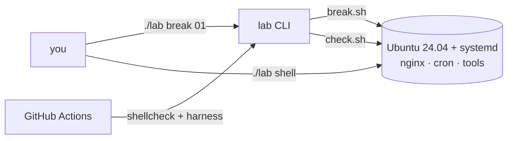

# linux-ops-lab

[](https://github.com/balbino-z/linux-ops-lab/actions/workflows/ci.yml)


**Break a real Linux server on purpose, then fix it like an on-call engineer.**
One command starts a disposable Ubuntu 24.04 machine with real `systemd`, nginx and cron. Another one starts an incident.
You investigate, fix it, and write the runbook.

<!-- GIF: ./lab break 01 → diagnosis → ./lab check 01 PASS (recorded when v1.0.0 ships) -->

## Why
I work in a 24/7 operations center, where the question is always the same: *"it's down — what do you check first?"*
This lab turns that question into practice: every scenario is a realistic ticket, and every fix ends in a runbook.

## Quick start
Requirements: Docker (Docker Desktop on Windows/macOS) and Bash (Linux, macOS, WSL or Git Bash).

```bash
git clone https://github.com/balbino-z/linux-ops-lab.git
cd linux-ops-lab
./lab up          # build and boot the machine (~1 min the first time)
./lab list        # see the scenarios
./lab break 01    # start an incident
./lab shell       # investigate as the "ops" user (sudo works)
./lab check 01    # PASS when it is really fixed
./lab reset       # fresh machine
```

## Scenarios
| # | Ticket | Skills | Runbook |
|---|---|---|---|
| 01 | Uploads fail with "No space left on device" | `df`, `du`, `lsof`, `systemctl` | [runbook](scenarios/01-disk-full/RUNBOOK.md) |

More are on the way: service won't start, port in use, runaway CPU, permission denied, DNS, and a combined "the site is down".

## How it works


- The machine runs **systemd as PID 1** inside a privileged container, so `systemctl` and `journalctl` behave like on a VM.
- `/srv/data` is a small 64 MB volume, so disk scenarios never touch your real disk.
- `check.sh` tests the **outcome** (the service works and stays working), not one specific fix.
- CI proves every scenario: a clean machine passes the check, a broken one fails it.

## Rules of the lab
- Don't read `break.sh` before you solve a scenario — it is the answer.
- Write the runbook yourself: symptom → diagnosis → root cause → fix → prevention ([template](docs/RUNBOOK-template.md)).

## How this was built
I designed this lab and built it with Claude Code as a pair programmer. Claude wrote the environment and the scenario harness;
**I solve every scenario and draft every runbook myself**; Claude then reviews the structure and the English (I'm improving my written English). The no-spoiler rule is enforced in [CLAUDE.md](CLAUDE.md).

## License
[MIT](LICENSE)
