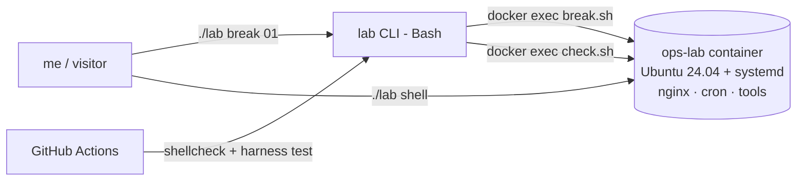

# PRD: linux-ops-lab

## Problem
Junior operations and cloud roles test one skill above all: *"the server is not responding — what do you do?"*
Reading about Linux does not build that reflex. Breaking a real system and fixing it does.

## Audience
1. **Me**: practice structured troubleshooting until I can do it out loud in an interview.
2. **Recruiters and tech leads**: proof, in runbooks, that I diagnose by layers instead of guessing.
3. **Anyone learning ops**: a free lab they can run with one command.

## MVP (v1.0.0)
- A disposable Ubuntu 24.04 machine in Docker with **real systemd** (so `systemctl` and `journalctl` work), nginx, cron and common tools.
- A `lab` CLI: `up`, `shell`, `list`, `break <id>`, `check <id>`, `reset`, `down`.
- 7 scenarios, each with a symptom README (no answer), `break.sh`, `check.sh` and a **RUNBOOK.md written by me after solving**:
  01 disk full · 02 service won't start · 03 port already in use · 04 runaway CPU · 05 permission denied · 06 DNS not resolving · 10 "the site is down" (combined)
- CI: shellcheck on every script, and a harness test proving each scenario breaks the machine and that a clean machine passes every check.
- `docs/troubleshooting-method.md`: my layered method.

## Out of scope (v1)
Kubernetes, cloud resources, a web UI, automatic solutions, scenarios 07–09 (memory, cron, TLS) — they come in v1.1.

## Stack and why
| Choice | Why |
|---|---|
| Docker with systemd as PID 1 | Reproducible on any machine with Docker; real `systemctl`/`journalctl` like a VM, without VirtualBox (which conflicts with Hyper-V/WSL2) |
| Bash for the harness | It is the language of the problem; shellcheck keeps it honest |
| GitHub Actions | Same Docker engine as locally, free for public repos |

## Architecture

## Success criteria
- `./lab up && ./lab break 01` reproduces the problem in under 60 s on a laptop.
- `./lab check 01` fails while broken and passes after my fix.
- 7 runbooks written by me, in English.
- CI green; release v1.0.0.

## Rule for AI use
Claude builds the lab (environment, harness, break/check scripts). **I solve every scenario and write every runbook myself.** Claude never reveals a cause or a fix unless I ask after solving.
